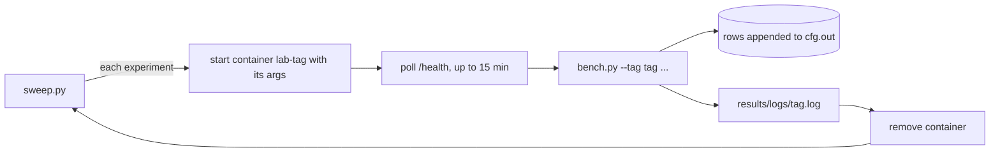

# sweep.py: one-knob-per-experiment runner

Source: [scripts/sweep.py](../scripts/sweep.py). Make targets: `make sweep3`, `make sweep4`.

`bench.py` measures **one server setup** under increasing load. `sweep.py` changes the **server setup** between runs and calls `bench.py` for each, so the curves can be compared.

## Flow



For each entry in `experiments`:
1. Merge `base` with the experiment (experiment keys **replace** base keys, so `args` replaces the base list entirely; it is not added to it).
2. Start a container via the Docker SDK: GPU(s), `ipc=host`, HF cache mounted, `HF_TOKEN` passed.
3. Wait for `GET /health == 200`. Fails fast if the container exits (prints the last 50 log lines).
4. Run `bench.py` with `cfg.bench_args` + `experiment.bench_args`, `--tag <experiment tag>`, `--out cfg.out`.
5. Always save the full container log to `results/logs/<tag>.log`, then remove the container.

## Config format

```yaml
base:
  image: vllm/vllm-openai:latest
  model: Qwen/Qwen3-8B
  port: 8000
  gpus: [0]
  args: [--max-model-len, 8192, --gpu-memory-utilization, 0.90]
bench_args: [--concurrency, 1, 4, 16, 32, 64, --input-tokens, 1024, --output-tokens, 256]
out: results/week3.csv
experiments:
  - tag: baseline                     # uses base.args
  - tag: fp8-kv
    args: [--max-model-len, 8192, --kv-cache-dtype, fp8]   # replaces base.args
  - tag: prefix-cache-on-shared
    args: [--max-model-len, 8192, --enable-prefix-caching]
    bench_args: [--shared-prefix]     # added to the shared bench_args
```

Per-experiment keys: `tag` (required), `engine` (`vllm`|`sglang`), `image`, `model`, `args`, `gpus`, `port`, `env`, `bench_args`.

## Before running
- `make down` first. The sweep binds the same port and needs the whole GPU.
- Run it on the GPU host (`make aws-ssh`), not your laptop.
- Long run: every experiment = model load + every concurrency level. Comment out experiments to run a subset.
- Compare experiments only against the **same sweep's** `baseline` row. Its `bench_args` (e.g. input length, levels) may differ from manual `make bench` runs.
- Because `args` replaces the base list, an experiment that omits `--gpu-memory-utilization` falls back to the vLLM default.

## After running
- Plot: `make plot` (week 3) / `make plot4`.
- Server-side evidence per experiment is in `results/logs/<tag>.log`:
  ```bash
  grep -Ei "KV cache|GPU blocks|maximum concurrency" results/logs/<tag>.log
  grep -E "Running:" results/logs/<tag>.log | tail
  grep -i preempt results/logs/<tag>.log
  ```
- Write up in `docs/findings/` (see [README](README.md)).
